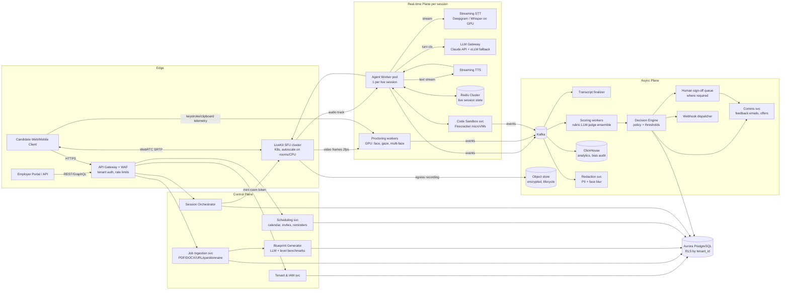

# 1. System Architecture & Data Flow

## 1.1 Capacity math

| Quantity | Value |
|---|---|
| Interviews/day | 50,000 × 45 min = 37,500 session-hours/day |
| Average concurrency | 37,500 / 24 ≈ 1,560 |
| Peak (regional business hours, ~3× avg) | **~4,700 concurrent; provision 6,000** (N+25%) |
| Media | ~1.5 Mbps up (720p) + 64 kbps audio per session → ~9 Gbps ingress peak |
| STT | 6,000 streaming audio channels |
| LLM turns | ~1 candidate turn / 20 s → ~300 turns/s peak, ~1.5k prompt tok (cached) + ~120 output tok |
| TTS | ~300 utterances/s, streamed |
| Recording storage | ~0.4 GB/interview (adaptive 480p archive) → ~20 TB/day before lifecycle deletion |

## 1.2 Component diagram

## 1.3 End-to-end data flow

1. **Intake.** Employer posts JD (text/file/URL/questionnaire) → `Job Ingestion` extracts text
   (Tika/OCR), normalizes into a `JobSpec` JSON (title, level, skills, dealbreakers, comp band).
   Company DNA is stored once per tenant and versioned.
2. **Blueprint.** `Blueprint Generator` maps `JobSpec` + level benchmarks (internal ladder
   library, e.g. SWE L3–L7, SDR→VP Sales) to a weighted `EvaluationRubric`: competencies,
   weights summing to 1, behavioral anchors per score level, question bank with follow-up
   trees and signal/noise indicators. Rubric is **frozen and versioned** before any
   candidate is interviewed (consistency + auditability). Bias lint pass rejects
   questions touching protected characteristics.
3. **Scheduling.** Candidates arrive via ATS sync, apply link, or sourcing integrations.
   Scheduling svc offers slots; capacity planner admits bookings against regional GPU/SFU
   quota so peaks are shaped, not dropped.
4. **Pre-flight.** Consent + AI disclosure (versioned text, logged), accommodation request,
   device check, ID document + liveness selfie → face match (1:1, stored as template hash,
   raw biometric deleted within 24h; opt-out → human-proctored alternative).
5. **Live interview.** Orchestrator creates LiveKit room, schedules an `Agent Worker` on a
   warm pool. Loop: VAD → streaming STT partials → endpointing (≈300ms silence + semantic
   end-of-turn) → LLM streams tokens → sentence-chunked TTS → audio out. Barge-in: when
   candidate VAD fires while TTS plays, cancel TTS + LLM stream, keep spoken prefix in
   context. Rubric state machine (coverage per competency, time budget) lives in Redis.
6. **Interactive modules.** Code: Monaco editor over WebSocket CRDT (Yjs), runs in
   Firecracker sandbox (no network, 2 vCPU, 10s CPU limit), hidden tests. Role-play and case
   modules swap the agent persona via tool call, same pipeline.
7. **Proctoring.** 2 fps frames → face count, face-match drift, gaze-off-screen ratio;
   audio → second-voice detection; client → focus/blur, clipboard, keystroke cadence.
   Produces *integrity signals* — never auto-reject on these alone; they lower confidence
   and route to review.
8. **Post-interview.** Kafka `session.completed` → transcript finalized with word timestamps
   → scoring ensemble (3 independent judge passes, per competency, must cite evidence spans;
   disagreement >1 point → 4th pass or human review) → `ScoringReport`.
9. **Decision.** Decision Engine applies tenant policy (thresholds, dealbreakers, knockout
   criteria, budget tier) → `Strong Hire / Hire / Hold / Reject` → sign-off queue if
   required → comms (constructive feedback / conditional offer) → webhook to employer/ATS.
10. **Lifecycle.** Redacted copies for reviewers; recordings deleted per tenant retention
    (default 180 days, candidate can request erasure); aggregates to ClickHouse for
    adverse-impact monitoring.

## 1.4 Latency budget (voice turn, p50 / p95 target ≤700ms / ≤1100ms)

| Stage | Budget |
|---|---|
| Network + jitter buffer (SFU co-located with agent) | 60 ms |
| Endpointing decision after speech stops | 250 ms |
| STT final (already streaming partials) | 50 ms |
| LLM time-to-first-sentence (prompt-cached system + rubric) | 220 ms |
| TTS time-to-first-audio | 90 ms |
| Playout | 30 ms |
| **Total** | **≈700 ms** |

Techniques: speculative LLM start on high-confidence partials; prompt caching of the static
prefix (system prompt + rubric + candidate profile); short "backchannel" fillers only when
a tool call (e.g. sandbox run) will exceed 1s; regional co-location of SFU, agent, STT,
TTS in the same AZ.

## 1.5 Scaling & fault tolerance

- **Agent workers:** stateless pods; all session state checkpointed to Redis every turn
  (`session:{id}:state`, TTL 6h). Pod death → orchestrator reschedules, new worker rejoins
  room within ~3s, says "Sorry, I lost connection for a second — you were saying…".
- **Autoscaling:** KEDA on custom metrics (`active_rooms`, `booked_sessions_next_15m`) —
  scale ahead of the schedule, not reactively. Warm pool = 10% of next-hour bookings.
- **SFU:** LiveKit multi-node with Redis routing; rooms pinned to a node; node drain on
  deploy.
- **Inference:** LLM gateway with per-tenant token buckets, provider failover (primary API
  → secondary region → self-hosted vLLM model), circuit breakers. STT/TTS likewise have
  two vendors behind one interface.
- **Kafka:** RF=3, idempotent producers, consumers keyed by `session_id` for ordering.
  Scoring is replayable from the event log + transcript.
- **Cells:** deploy as independent regional cells (US-East, EU-West, APAC) each sized for
  ~2,500 concurrent; EU tenants' data never leaves EU cell.
- **DR:** Aurora global DB (RPO <1s, RTO <5 min); S3 cross-region replication within the
  same legal zone.

## 1.6 Technology choices

| Concern | Choice | Reason |
|---|---|---|
| Media | LiveKit (self-hosted on EKS) | Open source SFU, agents SDK, egress recording |
| STT | Deepgram Nova streaming; Whisper-large-v3-turbo on vLLM as fallback | Latency + cost |
| LLM (interviewer) | Claude (Sonnet-class for turns; Opus-class for scoring/blueprints) | Tool use, instruction following; prompt caching |
| TTS | Cartesia Sonic / ElevenLabs Flash | <100 ms TTFA |
| OLTP | Aurora PostgreSQL + RLS | Tenancy isolation, mature |
| Live state | Redis Cluster | Sub-ms state |
| Events | Kafka (MSK) | Replay, ordering, throughput |
| Analytics | ClickHouse | Bias-audit aggregations at scale |
| Sandbox | Firecracker microVMs | Strong isolation for untrusted code |
